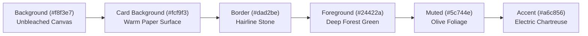
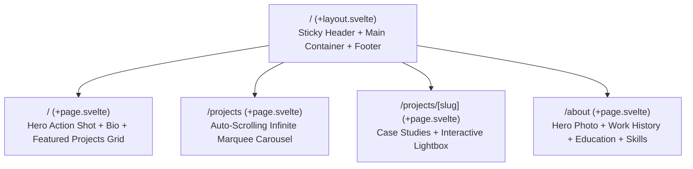

# Comprehensive Specification & Architectural Report: Iñigo Artolozaga UX Engineer Portfolio

> **Document Type**: Exhaustive System Specification, Sensory Design Audit, and Content Inventory  
> **Author**: Antigravity Pair Programmer  
> **Project Target**: Iñigo Artolozaga — UX Engineer Portfolio  
> **Repository**: `c:\src\portfolio`  
> **Version**: 1.0.0 (Production Ready)  

---

## 1. Executive Summary & Creative Vision

### 1.1 Overarching Philosophy & Aesthetic Identity
The portfolio of **Iñigo Artolozaga** is engineered as a dialogue between user experience research, human-robot interaction, and frontend design engineering. Rather than adhering to the polished, hyper-commercialized template patterns common among SaaS marketing pages or graphic design showcases, the website embodies **warm intellectual brutalism**—a synthesis of mid-century Swiss graphic design, modern technical telemetry, and warm tactile editorial printing.

The aesthetic evokes a premium, carefully typeset engineering notebook or an academic research monographs desk. Every structural decision prioritizes:
1. **Radical Transparency & Structure**: Raw data, camera parameters, date ranges, and categories are presented explicitly using monospace annotations (`//`).
2. **Tactile Warmth**: High-contrast, stark white-and-black interfaces are deliberately rejected in favor of an organic palette reminiscent of heavy unbleached paper, deep forest foliage, and electric citrus accents.
3. **Restraint over Decoration**: No unnecessary 3D canvas libraries, particle effects, or generic marketing jargon. Visual power is derived from typography, whitespace, candid high-resolution editorial photography, and rich, uncompromised case study content.

### 1.2 Target Persona & Professional Positioning
The site positions Iñigo as a specialized **UX Engineer** operating in the rigorous space where interaction design meets production software:
* **Current Role**: UX Engineer at **Fizyr** (Delft, Netherlands), engineering operator interfaces and computer vision configuration software for automated warehouse robotics.
* **Prior Experience**: UX Designer at **Salesdock** (sales CRM), UX Researcher at **Awaves**, and Personal Knowledge Management intern at **RemNote** (Berlin).
* **Academic Pedigree**: Double Master of Science degrees in Interaction Technology (University of Twente) and Human-Computer Interaction Design (Universidad Politécnica de Madrid), alongside an MSc in Digital Innovation (EIT Digital Master School) and a BSc in Computer Science.

---

## 2. Sensory Description, Color Theory & Visual System

If one were to perceive this website without sight, it must be understood as a physical object: a dense, heavy journal printed on matte Japanese cream cardstock with deep vegetable-based inks.



### 2.1 Complete Token Palette

| Token Identifier | Hex Code | Semantic Role & Visual Perception |
| :--- | :--- | :--- |
| `--color-background` | `#f8f3e7` | **Primary Canvas**: A soft, unbleached oat-milk / cream background. Provides warmth, eliminates eye strain, and gives the viewport a physical, tactile presence. |
| `--color-foreground` | `#24422a` | **Primary Ink / Typography**: A deep, saturated evergreen slate. Far softer than harsh `#000000`, conveying authority, organic depth, and precision. |
| `--color-muted-foreground`| `#5c744e` | **Secondary Metadata**: A muted moss/olive green used for descriptions, subtitles, dates, bullet copy, and auxiliary text. |
| `--color-muted` | `#eae3d1` | **Muted Fill**: Neutral warm stone used for inactive image containers, skeleton fallbacks, and subtle dividers. |
| `--color-accent` | `#a6c856` | **Interactive Energy**: High-energy chartreuse / electric lime. Used for text selection, active navigational indicators, hover states, and live status dots. |
| `--color-border` | `#dad2be` | **Structural Hairline**: A dry, chalky sand border that provides crisp delineation between cards, headers, and grid columns without heavy shadows. |
| `--color-card` | `#fcf9f3` | **Surface Elevate**: A lighter, ultra-clean cream surface used for card components, pill tags, and list boxes. |

### 2.2 Text Selection & Focus Mechanics
The tactile experience extends to user input:
* **Text Selection**: Highlighted text inverts the standard browser selection with `background-color: var(--color-accent) (#a6c856)` and `color: var(--color-foreground) (#24422a)`.
* **Focus States**: Focused links and buttons reveal an offset double-ring using `outline: 2px solid var(--color-accent)` with an `outline-offset: 2px` buffer, guaranteeing full keyboard accessibility.

### 2.3 Typography System
The typography leverages two contrasting, self-hosted typefaces bundled via `@fontsource` to eliminate external CDN dependencies and privacy tracking:

```
Space Grotesk (Sans) ──> Humanist Geometry, High Contrast, Wide Apertures (Headings, Body)
Space Mono (Monospace) ─> Telemetry, Time Stamps, EXIF Metadata, Category Prefixes
```

1. **Space Grotesk** (`400`, `500`, `600`, `700`):
   * Designed by Florian Karsten, Space Grotesk is a proportional sans-serif derived from Space Mono.
   * Features idiosyncratic ink-traps, wide proportions, and distinctive letterforms (such as the distinctive curved tail on the uppercase `Q` and single-story `a`).
   * Used for page titles (`4xl`–`6xl`), section headings (`2xl`), card titles (`lg`), and long-form narrative body paragraphs (`1.125rem` / `18px`, `line-height: 1.75`).
2. **Space Mono** (`400`, `700`):
   * A fixed-pitch geometric monospace typeface.
   * Utilized for structural signals: navigational labels (`text-sm`), uppercase section headers (`text-xs uppercase tracking-widest`), project years (`text-xs`), and EXIF metadata tags.

---

## 3. Information Architecture & Structural Blueprint



### 3.1 Global Frame Layout (`src/routes/+layout.svelte`)
The website is structured inside a global layout wrapper that ensures brand continuity across viewports:
* **Sticky Header (`Header.svelte`)**:
  * Positioned at `sticky top-0 z-50`.
  * Features a frosted backdrop filter: `bg-background/80 backdrop-blur border-b border-border`.
  * Brand mark: `<span class="text-accent">//</span> Iñigo Artolozaga` rendered in monospace.
  * Desktop Navigation: Links for `Home`, `Projects`, and `About`, tracking active state with `--color-accent`.
  * Mobile Navigation: An accessible hamburger toggle button (`☰` / `✕`) rendering an expandable slide-down drawer on mobile viewports.
* **Content Stage (`<main>`)**:
  * Centered with `max-w-5xl mx-auto w-full px-6 py-8`.
  * Styled with a smooth `animate-fade-in` CSS keyframe that lifts incoming page content by `4px` while fading opacity from 0 to 1 over 200ms.
* **Global Footer (`Footer.svelte`)**:
  * Separated by a hairline top border: `border-t border-border mt-16`.
  * Left telemetry signature: `// ux engineer` in monospace olive green.
  * Right contact cluster: Direct hyperlinks to GitHub (`inigofera`), LinkedIn (`inigoada`), and direct mailto (`inigo@artolozaga.dev`).

---

## 4. Exhaustive Page-by-Page Walkthrough

### 4.1 Home Page (`src/routes/+page.svelte`)

#### 4.1.1 The Action Shot Hero
The top of the landing page delivers an immediate visual statement:
* **The Canvas Breakout**: An expansive container spanning the entire browser width (`w-[100vw] max-h-[100svh] left-1/2 -translate-x-1/2 relative overflow-hidden style:aspect-ratio="3 / 2"`).
* **The Photograph (`/actionshot.jpg`)**: A candid, cinematic photograph showing Iñigo in an active creative/engineering environment, captured on high-end glass.
* **The Atmospheric Scrim**: A multi-stop vertical gradient (`bg-gradient-to-t from-black/80 via-black/40 to-transparent`) spans the bottom two-thirds of the hero, ensuring legible text contrast.
* **Hero Content Block**:
  * **Status & Role Badge**: An uppercase monospace label `UX ENGINEER` flanked by a pulsating lime green `StatusDot.svelte` in `active` mode.
  * **Name Typography**: A 5xl to 6xl bold title (`Iñigo Artolozaga`) in pure white.
  * **Short Bio**: *"UX engineer working between interaction design and frontend engineering. I build the components, dashboards, and configuration tools that make complex software feel simple."*
  * **Direct Actions**: Monospace action links to GitHub, LinkedIn, and Email with accent-colored hover underlines.
* **The Photographic Metadata Tag**:
  * Floating in the lower-right corner of the image is a two-line camera tag in white monospace:
    ```
    // action shot
    ILCE-7M4 · 7008 × 4672
    ```
  * Demonstrates technical precision, referencing Sony Alpha 7 IV full-frame capture parameters.

#### 4.1.2 Featured Projects Grid
* **Section Heading**: Clean `Featured Projects` header alongside a monospaced link `All projects →`.
* **Grid Presentation**: A responsive 2-column (tablet) to 3-column (desktop) grid displaying the top 3 projects (`buylocal`, `cashpool`, `shoppersmap`).

---

### 4.2 Projects Directory & Infinite Carousel (`src/routes/projects/+page.svelte`)

Instead of a conventional static list of cards, the `/projects` page introduces an interactive, auto-scrolling horizontal marquee.

```
◄─── [ BuyLocal ] ── [ CashPool ] ── [ ShoppersMap ] ── [ Design System ] ─── (Loop -50%) ◄───
```

#### 4.2.1 Marquee Mechanics & Mathematics
* **Continuous Array Doubling**:
  ```ts
  const half = [...projects, ...projects];
  const track = [...half, ...half];
  ```
  The track consists of the 4 projects replicated 4 times across two identical halves.
* **CSS Animation**:
  * `animation: marquee 80s linear infinite` translating from `translateX(0)` to `translateX(-50%)`.
  * Because the second half of the track is mathematically identical to the first half, when the animation resets at `-50%`, the loop is undetectable to the human eye.
* **Vignette Masking**:
  * Built using CSS mask gradients:
    `-webkit-mask-image: linear-gradient(to right, transparent, black 8%, black 92%, transparent)`.
  * Cards appear to emerge seamlessly from the left edge of the screen and dissolve softly before touching the right edge.
* **Tactile Interactivity**:
  * Pauses on hover or keyboard focus: `.marquee:hover .marquee-track, .marquee:focus-within .marquee-track { animation-play-state: paused; }`.
  * Users can hover to freeze a card, inspect its tags, or click into the detailed case study.
* **Accessibility**:
  * When `prefers-reduced-motion: reduce` is enabled, the infinite marquee animation is disabled, duplicate cards are hidden, and a native horizontal scroll container is enabled.

---

### 4.3 About Page (`src/routes/about/+page.svelte`)

#### 4.3.1 Hero Image & Split Layout
* **Visual Anchor (`/anotherpic.jpg`)**: A portrait hero featuring a dual-gradient scrim (vertical gradient at the bottom and horizontal gradient on the right).
* **Desktop Staggered Bio Fade-in**:
  * On desktop screens (`lg:block`), the right side of the hero overlay presents Iñigo's long-form bio.
  * Each paragraph uses a CSS keyframe animation (`bio-fade-in`) with a programmatic delay (`style:animation-delay="{i * 1000}ms"`):
    1. *Paragraph 1 (0s delay)*: Framing the focus on the unglamorous middle ground—design systems and configuration surfaces.
    2. *Paragraph 2 (1s delay)*: Current work at Fizyr (warehouse robotics interfaces) and Salesdock (sales CRM).
    3. *Paragraph 3 (2s delay)*: Academic foundations in user research (Twente, UPM, EIT Digital).
* **Metadata Overlay**: Top-right corner tag: `// about | ILCE-7M4 · 7008 × 4672`.

#### 4.3.2 Work History Timeline
Structured cards showcasing real commercial milestones:
1. **Fizyr** (`Jun 2025 — Present`, *Full-time · Delft, Netherlands*):
   * UX Engineer building robust, scalable UI components for Fizyr OS and operator interfaces.
   * Intuitive dashboards and configuration tools simplifying human-robot interaction on the warehouse floor.
   * Streamlining complex workflows for deploying and monitoring automated robotic cells.
2. **Salesdock** (`Dec 2022 — Jun 2025`, *Full-time · Enschede, Netherlands*):
   * Summary: *Multi-platform CRM platform oriented to sales.*
   * End-to-end design process, UX maturity enhancement, and external/internal knowledge management systems.
3. **Awaves** (`Jun 2022 — Dec 2022`, *Enschede, Netherlands*):
   * Junior UX Researcher running qualitative studies, user data analysis, and user flow prototyping.
4. **RemNote** (`Feb 2022 — Oct 2022`, *Internship · Berlin, Germany*):
   * UX Research Intern in Personal Knowledge Management.
   * Output paper: *"From Personal Knowledge to Community Knowledge: Stimulating Knowledge Sharing among Student Groups in Knowledge Management Platforms through Interaction Design"*.
5. **Accenture Song** (`Sep 2020 — Jul 2021`, *Internship · Madrid, Spain*):
   * Marketing Automation Intern specialized in Adobe Campaign Classic/Standard and Adobe Experience Cloud.
6. **Hive01 Enschede** (`Jan 2020 — Aug 2020`, *Greater Enschede Area, Netherlands*):
   * Distinct dual entries: **Chairman** (strategic leadership of diverse teams) and **Head of Marketing** (branding and multi-channel campaigns).
7. **Hive01 Enschede Season 5 Award** (`Feb 2019 — Jul 2019`, *Program award · Enschede, Netherlands*):
   * Winner of the "Best Startup Idea" award for an eHealth application detecting student mental health concerns.

#### 4.3.3 Academic Background
* **University of Twente**: MSc, Interaction Technology — User Experience Design (`Aug 2021 — Aug 2022`).
* **EIT Digital Master School**: MSc, Digital Innovation (`Sep 2020 — Jul 2022`).
* **Universidad Politécnica de Madrid**: MSc, Human-Computer Interaction Design (`Aug 2020 — Aug 2021`), *Final project: MedBot — an NLP-powered chatbot to assist first responders.*
* **University of Amsterdam**: Summer School, Data and Democracy — Data Journalism (`2021`).
* **University of Twente**: BSc, Computer Science (`2017 — 2020`), *Final thesis: Mental Health in a Pandemic, a Design and Interaction Perspective (Grade: 9.5/10).*
* **Tecnológico de Monterrey**: BSc Minor, International Marketing (`Aug 2019 — Jan 2020`).

#### 4.3.4 Skills Matrix
Presented under monospaced headers (`// category`) with pill tags:
1. `// ux design`: interaction design, design systems, user flows, prototyping, visual design.
2. `// design engineering`: ui components, component libraries, design tokens, typescript, html & css, accessibility.
3. `// research & strategy`: user research, usability testing, contextual inquiry, journey mapping, design sprints, ux maturity.
4. `// knowledge management`: knowledge sharing, information architecture, documentation, internal platforms.
5. `// human-robot interaction`: operator interfaces, configuration tooling, dashboards, workflow analysis.
6. `// marketing automation`: adobe campaign classic, adobe experience cloud, jira, confluence, scrum/agile.

---

### 4.4 Project Case Study Pages (`src/routes/projects/[slug]/+page.svelte`)

Each project route loads markdown content rendered into semantic HTML, equipped with interactive image exploration.

#### 4.4.1 Case Study Image Button Wrapping
In `src/lib/utils/markdown.ts`, raw HTML generated from markdown is parsed:
```ts
export function wrapImagesInButtons(html: string): string {
  return html.replace(/]*>/g, '<button type="button" class="case-study-image">$&</button>');
}
```
This turns every static image into an accessible, focusable trigger that keyboard users can activate with `Enter` or `Space`.

#### 4.4.2 The Advanced Pan/Zoom Lightbox (`Lightbox.svelte`)
Clicking any diagram, wireframe, or mockup launches a full-screen, GPU-accelerated inspection modal:
* **Native `<dialog>` Architecture**: Utilizes browser-native `dialog.showModal()`, trapping focus, locking background scroll (`overflow: hidden`), and managing backdrop clicks.
* **Interactive Zoom Capabilities**:
  * **Click Toggle**: Clicking toggles smoothly between viewport fit and 100% natural resolution.
  * **Cursor-Centered Wheel Zoom**: Scrolling zooms in/out up to `8x` (`MAX_SCALE`), dynamically recalculating offsets so the pixel directly underneath the mouse cursor stays stationary:
    $$\Delta x = \text{clientX} - \frac{W}{2}$$
    $$\text{offsetX} = \Delta x \cdot (1 - k) + \text{offsetX} \cdot k$$
  * **Clamped Panning**: When zoomed, users can click and drag to pan across diagrams, with boundaries clamped to prevent the image from escaping the screen:
    $$\text{clamp}\left(O_x, \frac{-W \cdot s}{2}, \frac{W \cdot s}{2}\right)$$
  * **Touch Gestures**: Multi-touch pinch-to-zoom using Euclidean distance calculations:
    $$d = \sqrt{(\Delta x)^2 + (\Delta y)^2}$$
  * **Live Telemetry & Navigation**: Displays current zoom percentage (`e.g. 145%`) and gallery index (`e.g. 3 / 12`). Supports keyboard navigation (`ArrowLeft`, `ArrowRight`, `+`, `-`, `0`).

---

## 5. Detailed Case Study Content Inventories

### 5.1 Case Study 1: BuyLocal
* **Core Problem**: During strict COVID-19 lockdowns, neighborhood supermarkets and independent corner stores struggled to survive while e-commerce giants captured market share. Customers wanted to support local business but lacked a digital bridge offering equivalent convenience.
* **Research Methodology**:
  * 10 in-depth qualitative interviews conducted remotely across India and Spain.
  * 2 contextual inquiries observing participants making real purchasing decisions in their living environments.
* **Key Findings**:
  * *Pain Points*: Frustration with high delivery thresholds, unpredictable delivery arrival windows, lack of stock visibility for fresh items, and fear of physical contact during contagion waves.
  * *User Persona*: Developed around conscious urban consumers who value produce freshness and local community resilience but have limited time for physical shopping trips.
* **Prototyped Workflows**:
  * *Task 1 (Fresh Produce)*: Buying artisanal cheese—comparing distance, price, and provenance across 3 nearby purveyors.
  * *Task 2 (Pantry Essentials)*: Ordering packaged cookies—selecting bulk pricing and choosing contactless doorstep drop-off.
* **Retrospective**: Demonstrates how reducing friction in checkout and order tracking empowers small merchants to compete against centralized logistics platforms.

### 5.2 Case Study 2: BuyLocal Design System
* **Foundational Need**: Translating the research discoveries of the BuyLocal project into a reusable, cross-platform mobile component library.
* **Component Architecture**:
  * *Store Cards*: Standardized display of merchant distance, operating hours, delivery fees, and community review ratings.
  * *Product Comparison Tokens*: Consistent typography and badge placements for discounts, unit pricing (e.g. `€/kg`), and live inventory counters.
  * *Checkout Flows*: Compact, modular stepper components for order customization, substitute item permissions, tip allocation, and live GPS rider tracking.
* **Design Output**: 12 high-fidelity screens illustrating light/dark contrast, accessibility compliance, and touch-target optimization for rapid single-handed mobile use.

### 5.3 Case Study 3: CashPool
* **Core Problem**: Young adults, roommates, and student groups frequently organize communal purchases (gifts, road trips, shared utilities) but encounter severe social friction around manual bookkeeping, chasing debts, and lack of fund visibility.
* **Research & Ideation Process**:
  * 5 Focus Group workshops simulating live cash pooling scenarios with artificial financial surprises (e.g. unforeseen expenses, split cancellations).
  * 17 individual user interviews paired with card-ranking exercises.
  * Discovery: Groups demand complete financial transparency, but individual contributors feel uncomfortable exposing their overall personal bank balances.
* **Design Execution**:
  * Task organization models separating "Pool Admin" responsibilities from "Contributor" permissions.
  * User Journey Maps tracing emotions from initial agreement through funding to balance reconciliation.
  * Lo-fi wireframes evolved into a high-fidelity prototype verified through rigorous usability testing.
* **Key Usability Corrections**:
  * Resolved confusion regarding automatic vs. manual fund release.
  * Created visual progress rings and automated notifications that eliminate the social awkwardness of peer debt collection.

### 5.4 Case Study 4: ShoppersMap
* **Core Problem**: In-store supermarket shopping for households is fragmented. Paper lists get lost, group members split up across aisles without coordination, and shoppers waste significant time backtracking to find obscure items.
* **Methodology & Investigation**:
  * 12 qualitative interviews analyzing list-making behavior (written lists vs. mental models vs. note apps).
  * 5-day Design Sprint synthesizing user pain points into an in-store spatial navigation prototype.
* **UEQ (User Experience Questionnaire) Quantitative Benchmark**:
  * 16 participants tested on a high-fidelity interactive prototype.
  * Scored well above benchmark in **Attractiveness**, **Perspicuity**, and **Novelty**.
* **Measured Usability Defects & Solutions**:
  * *Defect 1*: 81.25% of users struggled to manipulate the floor plan zoom controls.  
    *Solution*: Flipped `+` / `-` visual orientation and added auto-centering on active item aisles.
  * *Defect 2*: 75% did not realize tapping map icons revealed aisle shelf coordinates.  
    *Solution*: Replaced obscure map pins with categorical shopping list chips linked directly to aisle numbers.

---

## 6. Technical Implementation, Tooling & Build Engineering

### 6.1 Complete Tech Stack Breakdown

```
Runtime: Node.js / Bun
Framework: Svelte 5 (Runes Mode: $state, $derived, $props)
Meta-Framework: SvelteKit 2
Styling: Tailwind CSS v4 (@tailwindcss/vite)
Build Tool: Vite 8
Typography: @fontsource/space-grotesk, @fontsource/space-mono
Markdown Engine: markdown-it, markdown-it-anchor
Static Adapter: @sveltejs/adapter-static
```

### 6.2 Vite & Compiler Configuration (`vite.config.ts`)
```ts
import tailwindcss from '@tailwindcss/vite';
import adapter from '@sveltejs/adapter-static';
import { sveltekit } from '@sveltejs/kit/vite';
import { defineConfig } from 'vite';

export default defineConfig({
	plugins: [
		tailwindcss(),
		sveltekit({
			compilerOptions: {
				// Enforces modern Svelte 5 Runes mode across all first-party application source code
				runes: ({ filename }) => filename.split(/[/\\]/).includes('node_modules') ? undefined : true
			},
			adapter: adapter()
		})
	]
});
```

### 6.3 Static Build & Root Deployment Pipeline (`scripts/publish-root.mjs`)
To deploy cleanly to GitHub Pages without running complex orphan branch actions, the project utilizes an automated build-sync script:
1. `vite build` triggers `@sveltejs/adapter-static`, compiling and prerendering every route (`/`, `/about`, `/projects`, `/projects/buylocal`, etc.) into static HTML files located in the `build/` directory.
2. `scripts/publish-root.mjs` executes immediately post-build:
   ```js
   import { cpSync, readdirSync, rmSync } from 'node:fs';
   import { resolve } from 'node:path';

   const projectRoot = resolve(import.meta.dirname, '..');
   const buildDirectory = resolve(projectRoot, 'build');

   for (const entry of readdirSync(buildDirectory)) {
     const source = resolve(buildDirectory, entry);
     const destination = resolve(projectRoot, entry);
     rmSync(destination, { recursive: true, force: true });
     cpSync(source, destination, { recursive: true });
   }

   console.log('Published static site to the project root.');
   ```
3. Root HTML files (`index.html`, `about.html`, `projects.html`, `projects/*.html`) and the `_app/` immutable asset folder are committed directly to `master`, enabling instant GitHub Pages delivery from the root branch.

### 6.4 Diagnostic Health & Quality Metrics
* **TypeScript Compilation**: `svelte-check --tsconfig ./tsconfig.json` runs clean with **0 errors and 0 warnings**.
* **Zero Runtime Dependencies**: No heavy UI frameworks, CSS-in-JS libraries, or analytics scripts. First Contentful Paint (FCP) and Time to Interactive (TTI) are near-instantaneous.

---

## 7. Accessibility, Motion & Human Factors

1. **Semantic Landmark Architecture**:
   * Uses `<header>`, `<nav>`, `<main>`, `<section>`, `<figure>`, `<figcaption>`, and `<footer>` for predictable screen reader navigation.
2. **Keyboard Accessibility**:
   * All project cards, hero links, and markdown images are focusable via tab navigation with distinct, high-contrast focus rings.
   * Modals trap focus and exit cleanly on `Escape`.
   * Marquee items duplicated for animation looping include `tabindex="-1"` and `aria-hidden="true"` to prevent keyboard navigation trap or redundant screen reader announcements.
3. **Motion Sensitivity (`prefers-reduced-motion`)**:
   * Animations throughout the application respect user operating system settings.
   * Auto-scrolling marquees convert to touch-friendly scroll containers.
   * Hero bio fade-ins trigger instantaneously without opacity delays.

---

## 8. Summary Conclusion

The portfolio website for **Iñigo Artolozaga** stands as a cohesive, production-grade example of **design engineering**. Every pixel, token, and line of TypeScript serves a deliberate communicative purpose: reflecting a practitioner who can conduct rigorous user research, formulate elegant design systems, and execute robust, high-performance web software.

